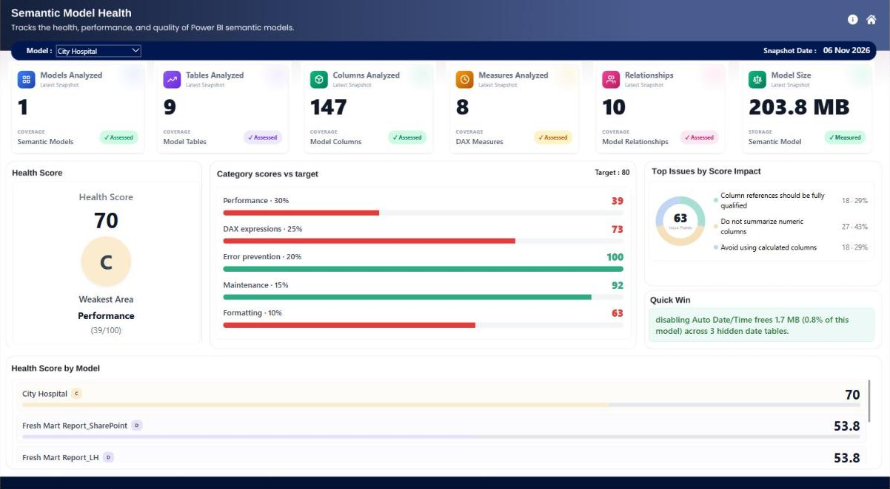
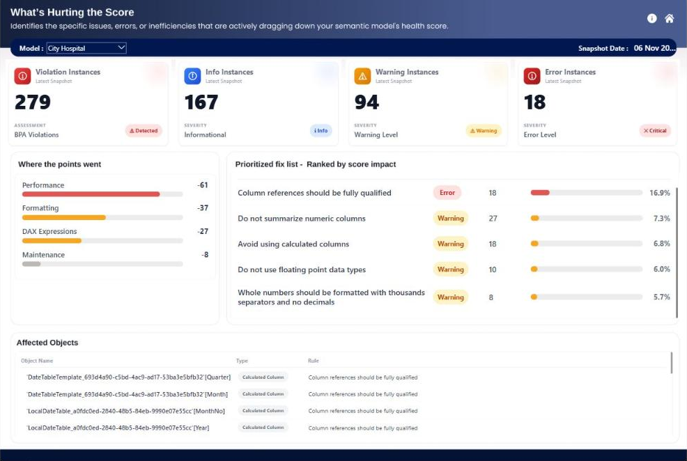
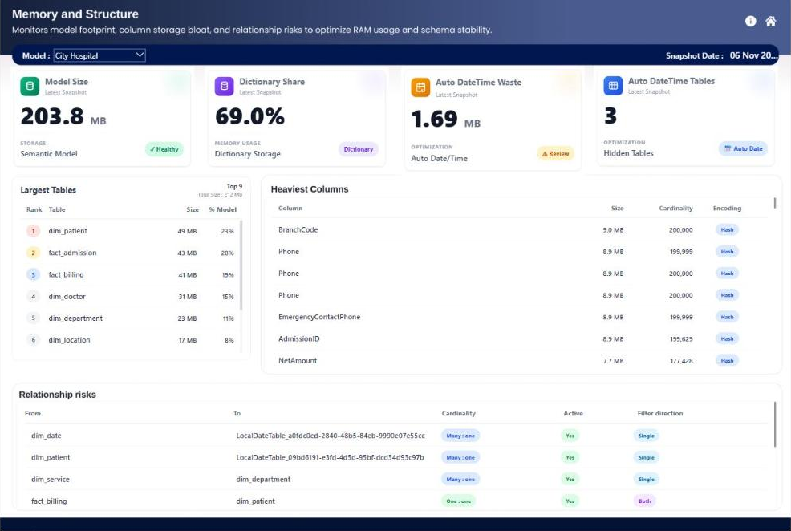
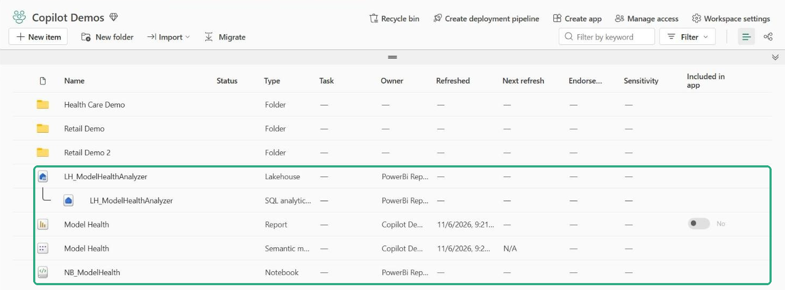
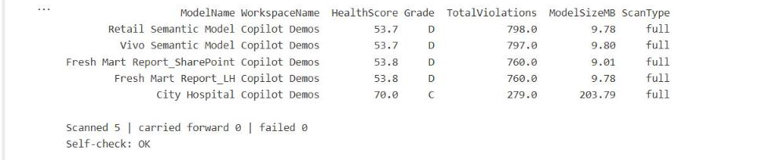

# Semantic Model Health for Microsoft Fabric

**Score every Power BI semantic model from 0 to 100, see exactly what's pulling it down, and get the fix. It installs from one notebook, with nothing to edit.**



## Demo

▶️ [Watch the 70-second demo](media/Model_Health_Demo.mp4): an empty workspace, one Run all, then the finished report.

## What you get

| Report page | What it shows |
|---|---|
| **Semantic Model Health** | Score and grade per model, five area scores, weakest area, top issues, one quick win |
| **What's hurting the score** | Every issue ranked by points lost, the exact objects behind it, how to fix it, effort and impact |
| **Memory and Structure** | Model size, heaviest tables and columns, hidden auto date tables, relationships to review |

Scores are kept daily, so you can follow each model's trend.

## Install (about 5 minutes)

1. Import [`NB_ModelHealth.ipynb`](NB_ModelHealth.ipynb) into a workspace on Fabric capacity (F2 or higher, Premium or Trial).
2. Click **Run all**.
3. Open the **Model Health** report in the same workspace.

You don't upload anything or change any settings. The notebook creates the lakehouse, scans the models, builds the Direct Lake model and the report, and schedules itself daily.

Optional: to scan other workspaces, set `WORKSPACES = ["Sales", "Finance"]`, or `["*"]` for all of them.

## Screenshots

| What's hurting the score | Memory and structure |
|---|---|
|  |  |

| Created by the notebook | Notebook summary |
|---|---|
|  |  |

## How it works

```
NB_ModelHealth (Python notebook, daily)
  ├─ find the models in the chosen workspaces
  ├─ skip models unchanged since the last scan
  ├─ Best Practice Analyzer + storage statistics + refresh history
  ├─ score 0–100, save Delta tables  →  LH_ModelHealthAnalyzer
  └─ first run: create the "Model Health" model + report from the built-in definition
                                  ↓
          Model Health report (Direct Lake: no refresh, no credentials)
```

## How the score works

1. Each broken rule costs points: **Error 10, Warning 4, Info 1**.
2. Repeats cost more, up to 3×: once = 1×, about 10 times = 2×, 100+ = 3×.
3. Each of five areas starts at 100 and loses the points of its rules.
4. **Health = 30% Performance + 25% DAX + 20% Error prevention + 15% Maintenance + 10% Formatting.**
5. Grades: A ≥ 90 · B ≥ 80 · C ≥ 65 · D ≥ 50 · F < 50.

Formula: `points = severity × min(3, 1 + log10(occurrences))`. The notebook and the report DAX use the same numbers.

## Safe by design

- **Read-only:** it reads metadata, DAX, sizes and refresh history, never table rows, and never changes your models.
- **No stored credentials:** it runs as the signed-in user.
- **Capacity friendly:** it uses a Python session (2 vCores), runs incrementally, and goes one model at a time with a cap per run.

## Requirements

- A Fabric or Premium capacity
- Contributor access on the workspaces to scan
- Notebooks allowed to install `semantic-link-labs` from PyPI

## Roadmap

- [ ] Safe fixes with preview, backup and re-score
- [ ] Alerts when a model drops a grade
- [ ] Usage-based ranking
- [ ] Custom rules and weights

## Documentation

| Document | For |
|---|---|
| [Overview](docs/Model_Health_Overview.docx) | What it does, how it works, how the score works |
| [Setup in a new workspace](docs/Model_Health_Setup_New_Workspace.docx) | Step-by-step install, stopping a test, troubleshooting |
| [User guide](docs/Model_Health_User_Guide.docx) | Every page, setting and table in detail |

## Credits

Built on Microsoft's [Semantic Link](https://learn.microsoft.com/fabric/data-science/semantic-link-overview), [Semantic Link Labs](https://github.com/microsoft/semantic-link-labs) and the Best Practice Analyzer rules.

Created by **Mohamed Fowzan**.
