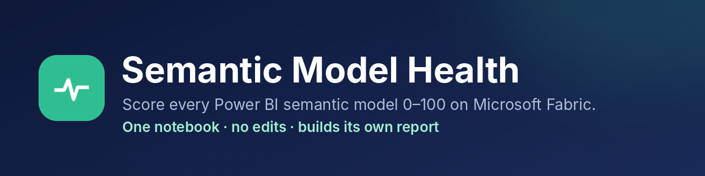
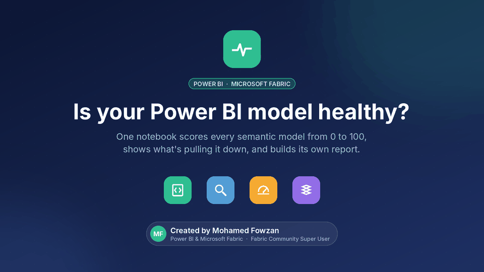
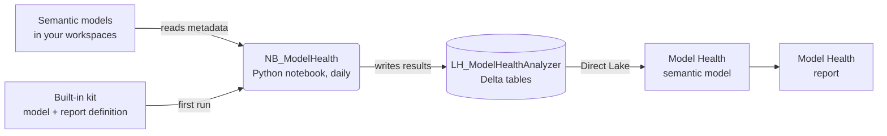

<p align="center">
  
</p>

<p align="center">
  
  
  
  
  
</p>

<p align="center">
  <b>Give every Power BI semantic model a health score from 0 to 100, see exactly what is pulling it down, and get the fix.</b><br>
  Import one notebook into Microsoft Fabric, click <b>Run all</b>, and it builds the lakehouse, the model and the report itself.
</p>

<p align="center">
  <a href="media/Model_Health_Demo.mp4"></a><br>
  <sub>▶ <a href="media/Model_Health_Demo.mp4">Watch the 74-second demo</a></sub>
</p>

---

## ✨ What you get

| | |
|---|---|
| 🩺 **A score and a grade per model** | 0–100 and A–F, across Performance, DAX, Error prevention, Maintenance and Formatting |
| 🎯 **What's hurting the score** | Every issue ranked by the points it costs, down to the exact table, column or measure |
| 🛠️ **How to fix it** | Fix guidance, effort and impact for the most common rules |
| 🧠 **Memory and structure** | Model size, heaviest tables and columns, hidden auto date tables, relationships to review |
| 🔄 **Refresh health** | Recent refreshes, failures and success rate |
| 📈 **Trend** | Scores are kept every day, so you can see a model getting better or worse |

<p align="center">
  
</p>

## 🚀 Quick start (about 5 minutes)

> **You need:** a workspace on Fabric capacity (F2 or higher, Premium or Trial) and Contributor access to the workspaces you want to check.

1. **Download** [`NB_ModelHealth.ipynb`](https://github.com/fowzanmohamed/semantic-model-health/releases/latest/download/NB_ModelHealth.ipynb) from the [latest release](https://github.com/fowzanmohamed/semantic-model-health/releases/latest).
2. In your workspace: **Import → Notebook → From this computer**.
3. Open it and click **Run all**.
4. Open the **Model Health** report in the same workspace.

That's it. You don't upload anything or change any settings: the dashboard is built into the notebook. From then on it runs every morning by itself.

<details>
<summary><b>Optional: check other workspaces</b></summary>

In the notebook's CONFIG cell, before Run all:

```python
WORKSPACES = ["Sales", "Finance"]   # or ["*"] for every workspace you can access
```
</details>

## ⚙️ How it works



- **Checks:** Microsoft's Best Practice Analyzer, storage statistics and refresh history, through [Semantic Link Labs](https://github.com/microsoft/semantic-link-labs).
- **Builds the report itself:** the model and report definitions are stored inside the notebook and created through the Fabric API. No Power BI Desktop needed.
- **Direct Lake:** the report reads the lakehouse directly, so there's no refresh to schedule and no credentials to store.

## 🧮 How the score works

Every model starts at 100 and loses points for each broken best-practice rule.

| Severity | Points lost | Meaning |
|---|---|---|
| 🔴 Error | 10 | Can give wrong results |
| 🟠 Warning | 4 | Slow or hard to maintain |
| 🔵 Info | 1 | Formatting, descriptions |

- **Repeats cost more, up to 3×.** Broken once = 1×, about 10 times = 2×, 100 or more = 3×. One habit repeated everywhere can't sink a good model.
- **Five areas, one score:** Performance 30% · DAX 25% · Error prevention 20% · Maintenance 15% · Formatting 10%.
- **Grades:** A ≥ 90 · B ≥ 80 · C ≥ 65 · D ≥ 50 · F < 50.

Formula: `points = severity × min(3, 1 + log10(occurrences))`. The notebook and the report use the same numbers.

## 🛡️ Safe by design

- **Read-only:** it reads structure, DAX, sizes and refresh history. It never reads table rows and never changes your models.
- **No stored credentials:** it runs as the signed-in user.
- **Capacity friendly:** it uses a Python session (2 vCores) instead of Spark, skips models that haven't changed, and checks one model at a time with a cap per run.

## 📸 Screenshots

| What's hurting the score | Memory and structure |
|---|---|
|  |  |
| **Created by the notebook** | **Notebook summary** |
|  |  |

## 📚 Documentation

| Document | For |
|---|---|
| [Overview](docs/Model_Health_Overview.docx) | What it does, how it works, how the score works |
| [Setup in a new workspace](docs/Model_Health_Setup_New_Workspace.docx) | Step-by-step install, stopping a test, troubleshooting |
| [User guide](docs/Model_Health_User_Guide.docx) | Every page, setting and table in detail |

## 🗺️ Roadmap

- [ ] **Safe fixes:** apply low-risk fixes with a preview, a backup and a re-score
- [ ] **Alerts:** know when a model drops a grade or a refresh fails
- [ ] **Usage ranking:** fix the most-used models first
- [ ] **Custom rules and weights**

Ideas and feedback are welcome in [Issues](../../issues).

## 🙌 Credits

Built on Microsoft's [Semantic Link](https://learn.microsoft.com/fabric/data-science/semantic-link-overview), [Semantic Link Labs](https://github.com/microsoft/semantic-link-labs) and the Best Practice Analyzer rules.

---

<p align="center">
  Created by <b>Mohamed Fowzan</b> · Power BI &amp; Microsoft Fabric · Fabric Community Super User<br>
  <sub>Released under the <a href="LICENSE">MIT licence</a>.</sub>
</p>
